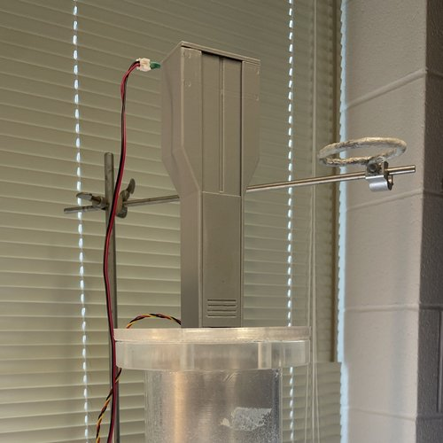

# turbidity-sensor

[](LICENSES/GPL-3.0-or-later.txt)
[](LICENSES/CERN-OHL-S-2.0.txt)

A low-cost turbidity sensor and its software. The sensing element is the bare board from a
TST-10-type probe, the one on DFRobot's SEN0189 module, in a printed case round a clear tube, read
by an Arduino Nano. Paired with a syringe that draws culture through the tube on a timer, it follows
the density of a culture in a vessel that is already running.

<!-- Run 1's first print, grey and on a clear lid. Replace with photos of the black reprint from run 2: #48 -->


## What's here

- **The head:** the bare board in one of two printed cases round a clear tube:
  [`hardware/tube-case/`](hardware/tube-case/README.md), a plain block for the bench or a liquid
  line, and [`hardware/sampler-case/`](hardware/sampler-case/README.md), which stands on a
  vessel's port under the syringe actuator. [`hardware/probe/`](hardware/probe/) is the board's
  measured outline, from which both size themselves. [`docs/hardware.md`](docs/hardware.md#setups)
  names the enclosures and covers the wiring.
- **Reading it:** [`examples/arduino-multichannel/`](examples/arduino-multichannel/) streams raw readings
  from up to four heads. [`tools/`](tools/) captures, summarises and plots them.
- **The sampler logger:** [`rig/pi/`](rig/pi/README.md) runs the syringe actuator
  ([uwo-fast/syringe-actuator](https://github.com/uwo-fast/syringe-actuator)) in timed bursts and picks
  the culture's reading out of each burst. It needs no position sensing and no valves.
- **The C library:** a model of the head from the manufacturer's curves, with a calibration tool. It
  applies to a head in its stock housing, not in the tube case: [`docs/library.md`](docs/library.md).
- **Data:** every bench session and run, with its notes, in [`data/bench/`](data/bench/).

## Status

- **Bench:** two heads in tube cases read kaolin standards from 250 to 4000 mg/L. Refilling the tube with
  clear water repeats within 0.05–0.11 %, about one ADC count
  ([`docs/bench/session-1-results.md`](docs/bench/session-1-results.md)).
- **Run 1:** the sampler followed a *Chlorella vulgaris* batch culture in a sparged column for about 7
  days, against a benchtop spectrophotometer (OD750).
  - A fit to the first four days predicted five later reads within 2.4 %. That holds only with four
    reads that carry recorded caveats left out of the fit; with them in, the later reads come out
    4.5–10.2 % off.
  - Record: [`data/bench/2026-11-05/notes.md`](data/bench/2026-11-05/notes.md).
- **Not yet:**
  - turbidity units, from a formazin series ([#23](https://github.com/uwo-fast/turbidity-sensor/issues/23));
  - picking on the Nano itself, for a BREAD DCMT slice ([run 2](docs/bench/algae-run-2-plan.md));
  - setting up the logger without editing it by hand ([#46](https://github.com/uwo-fast/turbidity-sensor/issues/46)).

## Repository map

- `include/`, `src/`: the C library; `src/` also holds the generated vendor-fit header
- `tools/`: the calibration CLI and generator, serial capture, summary and plot scripts, and the tube ray trace
- `examples/`: the Arduino examples and a host replay example
- `rig/pi/`: the sampler logger
- `hardware/`: the probe library, the tube case, the sampler case, and a flange that holds a TST-10 over a beaker
- `data/bench/`: bench sessions and runs; `data/calibration/`: vendor digitisations and generated calibration
- `docs/`: wiring, test solutions, the library, bench procedures; `docs/archive/`: earlier research and datasheets
- `tests/`: unit, CLI-contract, package smoke and logger tests

## Development

Tasks run through [`just`](https://github.com/casey/just); `just --list` shows them all.

```sh
just build    # configure and compile (warnings are errors)
just test     # build and run the test suite
just check    # clang-format check + clang-tidy (CI-equivalent)
just arduino  # compile the Arduino examples for every board
just capture  # record a board's serial log to CSV
```

`fmt`, `check` and CI use clang-format and clang-tidy 18.1.8.

Without `just`:

```sh
cmake -S . -B build -DBUILD_TESTS=ON -DBUILD_TOOLS=ON -DBUILD_EXAMPLES=ON
cmake --build build
ctest --test-dir build --output-on-failure
```

## License

Copyright © 2025–2026 Cameron Brooks.

This project is free software: you may redistribute it and/or modify it under the
terms of the GNU General Public License as published by the Free Software
Foundation, either version 3 of the License, or (at your option) any later version.
Hardware design files and the outputs generated from them are licensed instead
under [CERN-OHL-S-2.0](LICENSES/CERN-OHL-S-2.0.txt), except the sampler case,
which includes GPL libraries and stays GPL-3.0-or-later, and the bench and calibration
data under [CC-BY-4.0](LICENSES/CC-BY-4.0.txt). See [`LICENSING.md`](LICENSING.md)
for what applies where, including the third-party datasheets and standards this
repository does not license, and the organization
[licensing policy](https://github.com/uwo-fast/.github/blob/main/LICENSING.md) for
why.
