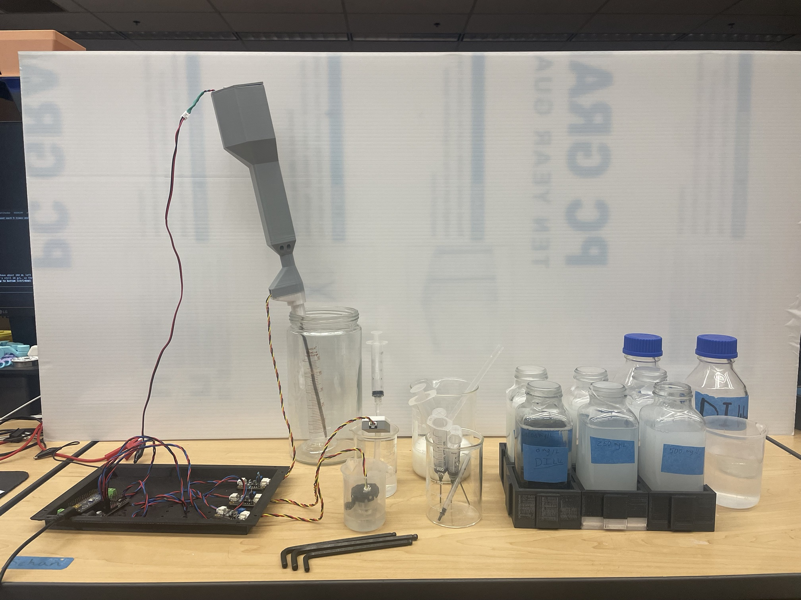
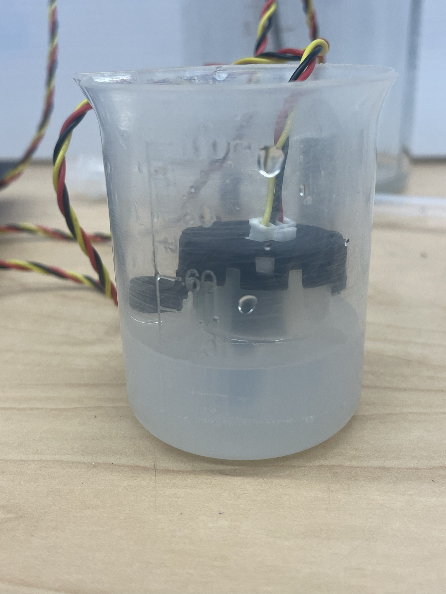

# Bench session 1: results

Bench work from 2026-10-24 to 10-29, following [`session-1.md`](session-1.md). The captures and
a running log for each day are in `data/bench/<date>/`; every figure here traces to them.
Concentrations are mg/L of kaolin, not NTU: the conversion needs a formazin calibration (#23).

Each head is normalized against its own captures: transmittance T = (mean − dark) / (clear −
dark), reported as percent change from clear, (T − 1) × 100, and as attenuation −ln T. The
tables come from `tools/plot_series.py` (`just plot`).

## Setup

A0 sits in its stock housing in a beaker; A1 and A2 are bare boards in printed tube cases,
each with its own tube and syringe. A2's case sits in a grey arm built for automated
sampling; the case, tube, syringe and light path are the same as A1's. More photos, including
the adapters with their load resistors, are in `data/bench/2026-10-28/photos/`.

## Heads

- **Screening (10-24):** of five heads, two hold a fixed output (788 and 709 counts) and do
  not respond to blocking the beam. A probe-cable swap pins the first fault to the probe; the
  second was tested on one adapter only.
- **Unit-to-unit spread (10-25):** three working heads read 636, 749 and 978 counts in air, and
  800, 957 and 980 in clear water. All three are DFRobot TST-10s, so this is spread between
  units of one part.
- **`RV` sets brightness.** Counter-clockwise dims a head. A0 read 980 in clear water, on the
  ADC's ceiling, and moved under 1 count up to 2000 mg/L in repeat 1; turned down to 787, it
  responded like the others ([`docs/hardware.md`](../hardware.md#probe-trimmer-rv)).

## Stock housings in a beaker (repeats 1 and 2)

Percent change from each repeat's blank, one capture per point. Each repeat ran in one 300 mL
beaker at constant volume (`data/bench/2026-10-26/`, `data/bench/2026-10-28/`).

| mg/L | A1, repeat 1 | A1, repeat 2 | A0, repeat 2 (RV set) |
| ---: | ---: | ---: | ---: |
| 25 | −0.1 | −1.3 | −1.0 |
| 100 | −0.1 | −1.3 | −1.0 |
| 200 | −0.6 | −1.3 | −1.0 |
| 400 | −1.4 | −1.9 | −1.8 |
| 800 | −3.6 | −3.3 | −3.2 |
| 1000 | −5.9 | −3.8 | −4.3 |
| 2000 | −12.7 | −7.5 | −8.3 |
| 4000 | −19.4 | −14.4 | −15.1 |

- **Two boards in one run agree:** A0 and A1 in repeat 2 stay within 0.8 points from 400 to
  4000 mg/L.
- **Runs do not:** A1 differs by up to 5.2 points between repeats.
- **The concentrations are uncertain.** The same head, A0, read −15.1 % at 4000 mg/L here and
  −79.1 % in a beaker of a bottled 4000 mg/L standard (below). Either the beaker draws
  carried less kaolin than intended (the 10 g/L stock settles within minutes, and was not
  shaken before every draw until partway through repeat 2), or the container changes the
  reading. These data show the direction of the response and the agreement within a run, not
  the response to a known concentration.
- In repeat 2 the drop from the blank to 25 mg/L (about 1 %) did not grow up to 200 mg/L; it is
  not explained.

## Tube case

Two boards, each in a printed case on its own vertical FEP tube (6.35 mm ID) and syringe, set up per
[`hardware/case/README.md`](../../hardware/case/README.md#optics-and-setup): `RV` fully
counter-clockwise, and a load resistor chosen for 850–880 counts in clear water (15 kΩ on A1,
6.8 kΩ on A2). Separate standards in capped bottles, five fills each, mean ± SD
(`data/bench/2026-10-28/`, captures `47_` to `49_`). A0 is a stock-housing head in a 100 mL
plastic beaker with 25–35 mL from the same bottle each time: enough to cover the emitter and
detector, below the rear cap where liquid would enter the housing.

| mg/L | A1 (tube) | A2 (tube) | A0 (stock, container) |
| ---: | ---: | ---: | ---: |
| 250 | −8.7 ± 0.3 | −4.9 ± 0.9 | −23 ± 14 |
| 500 | −19.7 ± 0.2 | −15.0 ± 0.2 | −20.4 ± 0.1 |
| 1000 | −36.5 ± 0.1 | −32.2 ± 0.4 | −33.2 ± 0.7 |
| 2000 | −63.1 ± 0.2 | −61.5 ± 0.3 | −58.2 ± 0.6 |
| 4000 | −85.7 ± 0.1 | −85.3 ± 0.2 | −79.1 ± 0.1 |

- **Repeatable:** refilling the tube with clear water moves the reading by 0.11 % (A1) and
  0.05 % (A2), standard deviation of five fills. Standards repeat within 0.1–1.0 points.
- **Beer–Lambert:** attenuation is close to proportional to concentration from 1000 to
  4000 mg/L. Per mg/L, A1 gives 4.5, 5.0 and 4.9 × 10⁻⁴, and A2 3.9, 4.8 and 4.8 × 10⁻⁴.
- **Between boards:** A1 and A2 differ by 4–5 points from 250 to 1000 mg/L and agree within
  0.4 points at 4000 mg/L.
- **Stable:** a clear fill after the series reads within 0.35 % of the reference on every head.
- **Before the setup,** a board in the case sat at 956–958 counts in clear water and moved
  −1.7 % at a nominal 4000 mg/L in beaker repeat 2. The water-filled tube concentrates the beam
  on the detector: with the load fixed, a board read 1.87 × as much with water in the tube as
  with it empty, against 1.26 × for a board in its stock housing in water against air
  (`tools/tube_raytrace.py` predicts 1.52 ×).
- A0's container is not repeatable at 250 mg/L (fills from −11 to −46 %), while its handling
  was still changing; from 500 mg/L up it repeats within 0.7 points. It reads within 0.7
  points of A1 at 500 mg/L and between the two tube heads at 1000 mg/L, then less
  attenuation than either at 2000 and 4000 mg/L.

## Conditions

- **Darkness:** A0's stock housing and A1's tube case are not dark by construction. Every
  covered capture ran under a large opaque plastic bin over the heads, with the room lights
  off and the shades drawn after dark; repeat 2 ran in the morning in a windowless room, under
  the same bin. The exceptions are named in the day's notes.
- **Room light** reaches the stock heads through a clear beaker: uncovered, A1 read 6.2 counts
  (0.8 %) higher, with its noise up from 0.16 to 0.42 counts (10-25); a blank taken with room
  light reaching the beaker read 25 counts (3.2 %) higher (10-26). The case head read the same
  covered and uncovered (956.8 and 956.7), but it sat near the ADC ceiling then, where it
  barely responds.
- **Bubbles** clinging to the stock heads' lenses after stirring read as large drops: two
  captures in repeat 1 read about 5 times the trend (−19.2 % against −3.6 % at 800 mg/L,
  −61.6 % against −12.6 % at 2000 mg/L) and recovered when repeated after clearing them (`data/bench/2026-10-26/photos/`).
- **Settling:** at 200 mg/L in the beaker, 5 minutes without stirring changed nothing beyond
  0.33 counts.
- **Tween 20 at 0.01 %:** clear readings in plain DI water and in the diluent differ by 0.2 %
  (A1) and 1.0 % (A2), but each was a separate fill, so this does not separate a Tween effect
  from fill-to-fill variation.
- **Dark:** a card in a stock head's gap let 3–7 counts through; metal blocks read 0.

## Limits

- **No NTU yet.** Kaolin's turbidity per mg/L depends on the batch (#23).
- **The beaker series' concentrations are uncertain** (above). The tube standards were made
  separately from shaken stock and are the better calibration.
- **Each tube head needs its own load resistor,** sized from its clear reading, and two boards
  set up the same way still differ by 4–5 points at low concentration. A third board would show
  how much of that is general (#24).
- **Resolution:** the 10-bit ADC gives about 4.6 mV per count at 4.7 V, and the clear-fill
  noise of 0.05–0.11 % is about one count.
- The capture tool missed the board reset several times, and one failed capture emptied a
  clear-reference file (`47_tube_clear_8.csv`; its means are in the 10-28 notes) (#21, #22).
