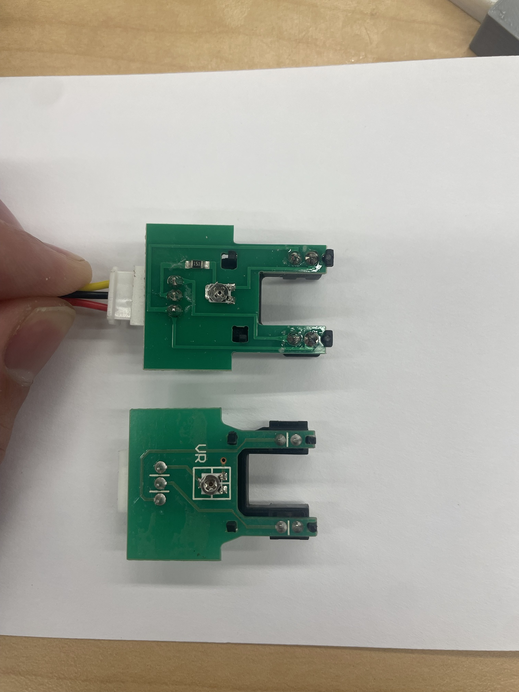

# Hardware

## Sensing chain

```text
TSW-10 / TST-10 probe  ->  interface (adapter board or bare resistors)  ->  5 V AVR ADC (A0-A3)
```

The probe is an infrared emitter and phototransistor facing each other across a water gap.
It needs a load resistor on its output and a current-limiting resistor on its emitter.
Those come either from an adapter board or from two resistors on a breadboard. The
`arduino` example reads one head on `A0`; the `arduino-multichannel` logger reads up to
four on `A0`–`A3`.

The lab has several `TSW-10` and `TST-10` heads, bought from
[DFRobot](https://www.dfrobot.com/product-1394.html) (with the SEN0189 adapter), from DigiKey
([TST-10](https://www.digikey.ca/en/products/detail/amphenol-advanced-sensors/TST-10/4767842),
[TSW-10](https://www.digikey.ca/en/products/detail/amphenol-advanced-sensors/TSW-10/4250485))
and from Mouser. The probe board inside differs by source:



- **DFRobot:** a different trace layout, and a 150 Ω resistor (marked `151`) in series with
  the signal.
- **Amphenol, from DigiKey:** no `151`; the trimmer is silkscreened `VR`.

The lab's TSW-10 and the other non-DFRobot heads also lack the resistor. Its effect on the
reading has not been measured. Record each head's model and source with its data.

## Setups

The same probe board can see its sample in three ways. All of them use the same
electronics and firmware.

| Setup | Housing | Sample | Vendor curves apply |
| --- | --- | --- | --- |
| Stock `TSW-10` | Amphenol housing, made to mount in a washer's water path | Water flows past the head | Yes |
| Stock `TST-10` | Amphenol housing, made to sit submerged in a tank | The head is immersed | Yes |
| Tube | Housing removed; bare board in the printed case ([`hardware/case/`](../hardware/case/README.md)) | Flows through a clear tube in the optical slot | No |

The stock housings are the supported default: most users will not open a probe. The tube
setup trades the housing's optical window for two tube walls and a 6.35 mm water column
(with 5/16 x 1/4 in tubing), so it needs its own calibration. It also fits into other
builds: the case is a plain box that other OpenSCAD projects can `include`.

Whatever the setup, per-head dark and clear-water references (see
[`docs/bench/session-1.md`](bench/session-1.md)) make heads comparable with each other.

## Probe trimmer (RV)

Every probe in the lab (TSW-10 and TST-10, from DFRobot, DigiKey and Mouser) has a trimmer
on a small board inside its plastic housing (silkscreened `VR` on the Amphenol board;
these docs call it `RV`). The Amphenol datasheet
schematic does not show it. On the bench it sets how bright the head reads: **turning it
counter-clockwise, viewed from above, lowers the output**, and clockwise raises it
(`data/bench/2026-10-26/notes.md`, `data/bench/2026-10-28/notes.md`). The
counter-clockwise end stop is the dimmest setting.

Heads ship with it set anywhere. One stock head read 980 counts of 1023 in clear water,
on the ADC's ceiling, and moved less than 1 count at kaolin concentrations that moved
another head by 6 %. After its `RV` was turned down, it read 787 and responded like the
other head.

- Before turning it, mark the trimmer's position (a fine-tip permanent marker across the
  slot and onto the board) and photograph both sides of the board. Then take air,
  clear-water and dark references in the setup the head will run in, stock housing or
  tube case, so the setting it shipped with stays on record.
- Check each head's clear-water reading. Above about 950 counts it sits near the
  ceiling and barely responds. Turn `RV` counter-clockwise until it reads about 800–880,
  and record the change with the head's data.
- After a turn, let the head settle in clear water: one head moved about 35 counts over
  ten minutes before it steadied. Take references once it is steady.
- In the printed tube case, `RV` alone is not enough; see
  [`hardware/case/README.md`](../hardware/case/README.md#optics-and-setup).

## Default path: DFRobot SEN0189 adapter

Bench work starts with the DFRobot SEN0189 adapter, the interface board the lab has most
of. The notes below come from DFRobot's
[V1.0 schematic](https://github.com/Arduinolibrary/DFRobot_Turbidity_sensor/blob/master/SEN0189%20Turbidity%20sensor(V1.0)%20schematic.pdf)
(dated 2015-06-19). The lab's DFRobot boards are marked "Turbidity sensor V1.0", the same
revision.

The adapters that came with the DigiKey and Mouser probes use similar circuits (an op amp
with resistors and capacitors) with different connectors and board shapes. They have not
been checked against this schematic, so run the adapter check below on each one.

| Stage | Parts | Effect |
| --- | --- | --- |
| Probe load | R7 4.7 kΩ, sensor output to GND | Same as the datasheet's `Ro` |
| Emitter current | R6 500 Ω, emitter cathode to GND | Datasheet `Ri` is 470 Ω, so the emitter current is about 6% lower |
| Analog buffer | R9 10 kΩ into U1B (LMV358) as a unity-gain follower, then R8 1 kΩ and C3 100 nF | **Gain 1**, low-pass at about 1.6 kHz |
| Digital output | U1A (LMV358) comparing the sensor against the RP1 10 kΩ pot, with an LED | High/low threshold only |
| Mode switch | SW1 | `A` puts the analog buffer on the output pin, `D` the comparator |

What this means in practice:

- **Set the switch to `A`.** The Arduino example reads the analog output.
- **The pot (RP1) does nothing in `A` mode.** It only sets the digital threshold, so
  leave it alone.
- **The output is the probe voltage, unchanged.** The buffer has unity gain and the load
  resistors match the datasheet test circuit, so the Amphenol vendor curves, and this
  repo's model, apply to the adapter output. The 500 Ω emitter resistor makes the output
  slightly lower than with the datasheet's 470 Ω.
- DFRobot's own reference: `4.1 ± 0.3 V` in clear water (below 0.5 NTU) at 10–50 °C.
- **The emitter cannot be switched off** without modifying the board, because R6 goes
  straight to GND. The `uno_switched_emitter` build (dark readings for ambient light)
  needs the bare wiring below.

### Wiring

- **Probe to adapter:** plug the probe cable into the adapter's probe connector.
- **Adapter to Arduino:** use the 3-pin Gravity output connector. On a DFRobot Gravity
  cable the signal wire is blue (to `A0`), `VCC` is red (to `5V`) and `GND` is black
  (to `GND`). If the board is marked, go by its markings.
- **Unused inputs:** an unconnected input does not read 0. It reads the charge left by
  the input sampled before it, so on the multichannel logger an empty `A3` follows `A2`.
  Ignore its column, or tie it to GND.

### Checking an adapter

Boards from other sources, or other revisions, may not match this schematic. Check each
adapter once, with the probe connected, powered, dry and unblocked, with the switch at `A`:

1. Measure the probe's output pin (the middle pin of the probe connector) to GND.
2. Measure the adapter's signal output to GND.
3. The two should agree within a few tens of millivolts. If they differ by more, the board
   is not a unity-gain buffer, and the vendor-curve envelope does not apply to it. Note
   the ratio, and label the board.

Repeat with the gap blocked by an opaque card. Both readings must drop together.

## Alternative: bare wiring

Without an adapter, wire the datasheet test circuit directly:

| Sensor pin | Function | Connect to |
| --- | --- | --- |
| 1 | VCC (emitter anode, phototransistor collector) | +5 V |
| 2 | Output (phototransistor emitter) | `A0`, and `Ro` 4.7 kΩ to GND |
| 3 | Emitter diode cathode | `Ri` 470 Ω to GND, or to `D7` for the `uno_switched_emitter` build |

With the switched-emitter build, the firmware drives `D7` high to turn the emitter off
before each sample and logs `dark_adc_counts`, the reading from ambient light alone.

## Supply and reference

Power the sensor or adapter from the same 5 V rail the ADC uses as its reference. The
emitter current, and so the output, rises with the supply, so a shared reference
cancels part of the supply variation. It is not fully ratiometric, because the diode
forward voltage does not scale with the supply.

Use a 5 V board. The output reaches about 4.8 V, beyond the ADC range of 3.3 V boards
such as ESP32 or RP2040, which would need a divider.
