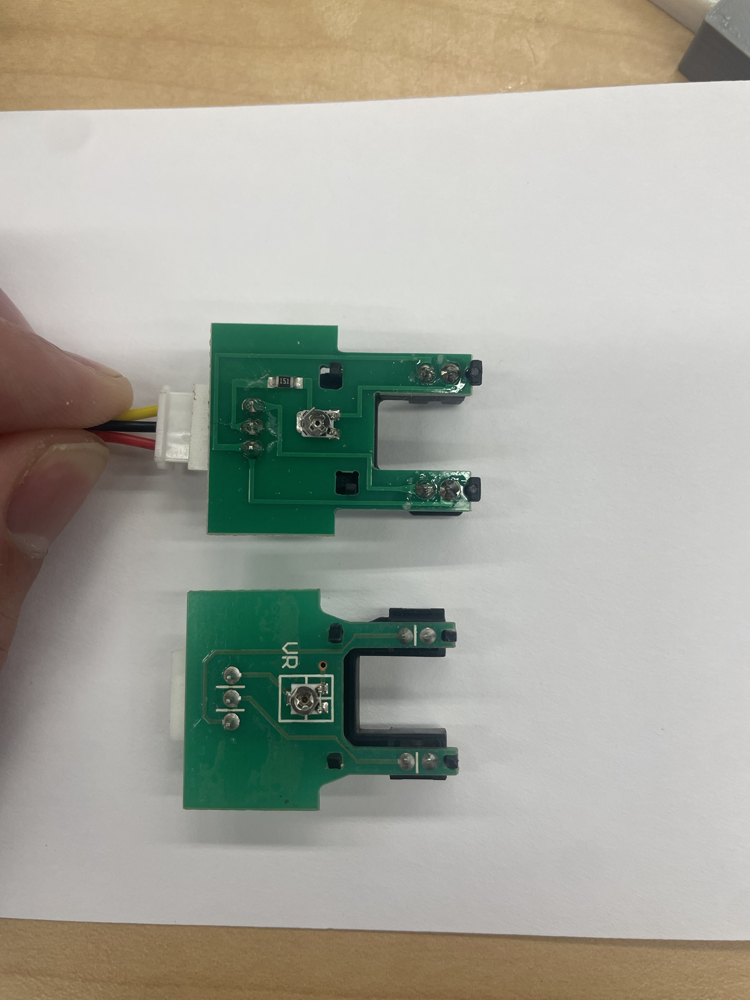

# Hardware

## Sensing chain

```text
TSW-10 / TST-10 probe  ->  interface (adapter board or bare resistors)  ->  5 V AVR ADC (A0-A3)
```

The probe is an infrared emitter and phototransistor facing each other across a water gap.
It needs a load resistor on its output and a current-limiting resistor on its emitter.
Those come either from an adapter board or from two resistors on a breadboard. The
`arduino` example reads one head on `A0`. The `arduino-multichannel` logger reads up to
four on `A0`–`A3`.

The lab has several `TSW-10` and `TST-10` heads, bought from
[DFRobot](https://www.dfrobot.com/product-1394.html) (with the SEN0189 adapter), from DigiKey
([TST-10](https://www.digikey.ca/en/products/detail/amphenol-advanced-sensors/TST-10/4767842),
[TSW-10](https://www.digikey.ca/en/products/detail/amphenol-advanced-sensors/TSW-10/4250485))
and from Mouser. The probe board inside differs by source:



- **DFRobot:** a different trace layout, and a 150 Ω resistor (marked `151`) in series with
  the signal.
- **Amphenol, from DigiKey:** no `151` resistor. The trimmer is silkscreened `VR`.

The TSW-10 in the lab and the other non-DFRobot heads also lack this resistor. Its effect on
the reading has not been measured. Record the model and source of each head with its data.

## Setups

The probe board is used in one of three enclosures. All of them use the same electronics
and firmware.

- **Stock housing:** the original Amphenol housing of the probe, as bought.
- **Tube case:** a printed rectangular case around the bare board, with a clear tube through
  its optical slot ([`hardware/tube-case/`](../hardware/tube-case/README.md)).
- **Sampler case:** the same pocket and tube, with a foot below that mounts it on a vessel
  port, and a face on top for the syringe actuator
  ([`hardware/sampler-case/`](../hardware/sampler-case/README.md)).

The tube case and the sampler case are the **printed cases**. For the board they are the same
setup, with the same pocket, tube and light path. A board needs the same load resistor and
gives the same readings in either. They differ only in how much ambient light reaches the
tube, which can be handled with a dark reference, a rebaseline or a shade.

| Setup | Enclosure | Sample | Load resistor | Vendor curves apply |
| --- | --- | --- | --- | --- |
| Stock `TSW-10` | Stock housing, designed to mount in the water path of a washer | Water flows past the head | No | Yes |
| Stock `TST-10` | Stock housing, designed to sit submerged in a tank | The head is immersed | No | Yes |
| Tube | Tube case or sampler case | Flows through the clear tube | Yes | No |

The stock housings are the supported default, because most users will not open a probe.
The tube setup replaces the optical window of the stock housing with two tube walls and a
6.35 mm water column (with 5/16 x 1/4 in tubing), so it needs its own calibration and a load
resistor
([`hardware/tube-case/README.md`](../hardware/tube-case/README.md#optics-and-setup)). The tube
case is also a plain box that other OpenSCAD projects can `include`.

In any setup, dark and clear-water references for each head (see
[`docs/bench/session-1.md`](bench/session-1.md)) make the heads comparable with each other.

## Probe trimmer (RV)

Every probe in the lab (TSW-10 and TST-10, from DFRobot, DigiKey and Mouser) has a trimmer
on a small board inside its stock housing (silkscreened `VR` on the Amphenol board, and
called `RV` in these docs). The Amphenol datasheet schematic does not show it. Bench tests
show that it sets the output level of the head: **turning it counter-clockwise, viewed from
above, lowers the output**, and turning it clockwise raises it
(`data/bench/2026-10-26/notes.md`, `data/bench/2026-10-28/notes.md`). The
counter-clockwise end stop is the dimmest setting.

Heads ship with the trimmer at an arbitrary setting. One stock head read 980 counts of 1023
in clear water, at the top of the ADC range, and changed by less than 1 count at kaolin
concentrations that changed another head by 6 %. After its `RV` was turned down, it read 787 and responded like the
other head.

- Before turning it, mark the trimmer position (a fine-tip permanent marker across the
  slot and onto the board) and photograph both sides of the board. Then take air,
  clear-water and dark references in the setup the head will be used in (stock housing or
  tube case), so the factory setting is recorded.
- Check the clear-water reading of each head. Above about 950 counts, the head is near the
  top of the ADC range and barely responds. Turn `RV` counter-clockwise until it reads
  about 800–880, and record the change with the data for that head.
- After adjusting it, let the head settle in clear water. One head drifted about 35 counts
  over ten minutes before it became steady. Take references once it is steady.
- In a printed case (tube or sampler), adjusting `RV` alone is not enough. See
  [`hardware/tube-case/README.md`](../hardware/tube-case/README.md#optics-and-setup).

## Default path: DFRobot SEN0189 adapter

Bench work uses the DFRobot SEN0189 adapter by default, because it is the interface board
the lab has most of. The notes below are based on the DFRobot
[V1.0 schematic](https://github.com/Arduinolibrary/DFRobot_Turbidity_sensor/blob/master/SEN0189%20Turbidity%20sensor(V1.0)%20schematic.pdf)
(dated 2015-06-19). The DFRobot boards in the lab are marked "Turbidity sensor V1.0", the
same revision.

The adapters that came with the DigiKey and Mouser probes use similar circuits (an op amp
with resistors and capacitors) with different connectors and board shapes. They have not
been checked against this schematic, so run the adapter check below on each one.

| Stage | Parts | Effect |
| --- | --- | --- |
| Probe load | R7 4.7 kΩ, sensor output to GND | Same as `Ro` in the datasheet |
| Emitter current | R6 500 Ω, emitter cathode to GND | Datasheet `Ri` is 470 Ω, so the emitter current is about 6% lower |
| Analog buffer | R9 10 kΩ into U1B (LMV358) as a unity-gain follower, then R8 1 kΩ and C3 100 nF | **Gain 1**, low-pass at about 1.6 kHz |
| Digital output | U1A (LMV358) comparing the sensor against the RP1 10 kΩ pot, with an LED | High/low threshold only |
| Mode switch | SW1 | `A` puts the analog buffer on the output pin, `D` the comparator |

What this means in practice:

- **Set the switch to `A`.** The Arduino example reads the analog output.
- **The pot (RP1) does nothing in `A` mode.** It only sets the digital threshold, so
  leave it alone.
- **The output is the probe voltage, unchanged.** The buffer has unity gain and the load
  resistors match the datasheet test circuit, so the Amphenol vendor curves, and the
  model in this repository, apply to the adapter output. The 500 Ω emitter resistor makes
  the output slightly lower than with the 470 Ω in the datasheet.
- DFRobot gives a reference of `4.1 ± 0.3 V` in clear water (below 0.5 NTU) at 10–50 °C.
- **The emitter cannot be switched off** without modifying the board, because R6 goes
  straight to GND. The `uno_switched_emitter` build (dark readings for ambient light)
  needs the bare wiring below.

### Wiring

- **Probe to adapter:** plug the probe cable into the probe connector on the adapter.
- **Adapter to Arduino:** use the 3-pin Gravity output connector. On a DFRobot Gravity
  cable the signal wire is blue (to `A0`), `VCC` is red (to `5V`) and `GND` is black
  (to `GND`). If the board is marked, go by its markings.
- **Unused inputs:** an unconnected input does not read 0. It reads the charge left by
  the input sampled before it, so on the multichannel logger an empty `A3` follows `A2`.
  Ignore its column, or tie it to GND.

### Checking an adapter

Boards from other sources, or other revisions, may not match this schematic. Check each
adapter once, with the probe connected, powered, dry and unblocked, with the switch at `A`:

1. Measure the probe output pin (the middle pin of the probe connector) to GND.
2. Measure the adapter signal output to GND.
3. The two should agree within a few tens of millivolts. If they differ by more, the board
   is not a unity-gain buffer, and the vendor-curve envelope does not apply to it. Note
   the ratio, and label the board.

Repeat with the gap blocked by an opaque card. Both readings must drop together.

## Alternative: bare wiring

Without an adapter, wire the datasheet test circuit directly:

| Sensor pin | Function | Connect to |
| --- | --- | --- |
| 1 | VCC (emitter anode, phototransistor collector) | +5 V |
| 2 | Output (phototransistor emitter) | `A0`, and `Ro` 4.7 kΩ to GND |
| 3 | Emitter diode cathode | `Ri` 470 Ω to GND, or to `D7` for the `uno_switched_emitter` build |

With the switched-emitter build, the firmware drives `D7` high to turn the emitter off
before each sample and logs `dark_adc_counts`, the reading from ambient light alone.

## Supply and reference

Power the sensor or adapter from the same 5 V rail the ADC uses as its reference. The
emitter current, and so the output, rises with the supply, so a shared reference
cancels part of the supply variation. It is not fully ratiometric, because the diode
forward voltage does not scale with the supply.

Use a 5 V board. The output reaches about 4.8 V, beyond the ADC range of 3.3 V boards
such as ESP32 or RP2040, which would need a divider.
